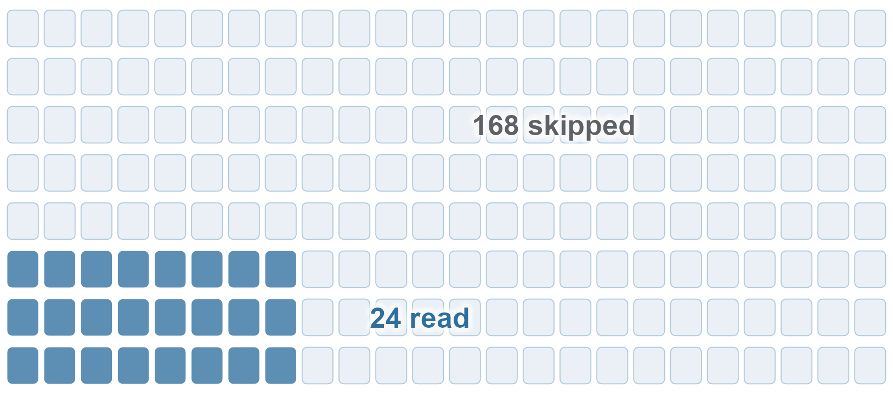

# vectra 

*querying data that won't fit in memory*

<!-- badges: start -->

[](https://CRAN.R-project.org/package=vectra) [](https://cran.r-project.org/package=vectra) [](https://cran.r-project.org/package=vectra) [](https://github.com/gcol33/vectra/actions/workflows/R-CMD-check.yml) [](https://github.com/gcol33/vectra/actions/workflows/sanitizers.yml) [](https://app.codecov.io/gh/gcol33/vectra) [](https://opensource.org/licenses/MIT) <!-- badges: end -->

<p align="center">


</p>

vectra runs [dplyr](https://dplyr.tidyverse.org)-style queries on files that are too large to load into memory: multi-gigabyte CSV and Parquet files, SQLite databases, GeoTIFF rasters and its own `.vtr` columnar format.

The verbs build a lazy query plan, and `collect()` executes it in a C11 engine that pulls one row group (a block of rows that is stored and decoded together) through the plan at a time. Peak memory therefore stays bounded however large the file is. Row groups whose stored minimum and maximum rule out a filter are skipped without being read. You decide what comes back into R: a result small enough to fit, or a stream that feeds a model fit or a file.

vectra supports:

- **Larger-than-memory queries.** `filter()`, `mutate()`, `group_by()` with `summarise()`, joins and window functions stream through the engine, and sorts, joins and aggregations spill to disk when they reach a memory budget ([Working with Large Data](https://gillescolling.com/vectra/articles/large-data.html)).
- **Several file formats.** `.vtr`, Parquet, CSV, SQLite and GeoTIFF open into the same lazy query nodes, so one pipeline runs against any of them ([Format Backends](https://gillescolling.com/vectra/articles/formats.html)).
- **Skipping what a query does not need.** The scan reads only the columns a query references, and row group statistics and optional hash indexes skip row groups that cannot match a filter ([Indexing and Query Optimization](https://gillescolling.com/vectra/articles/indexing.html)).
- **Fuzzy matching and geometry in expressions.** The string distances `levenshtein()`, `dl_dist()` and `jaro_winkler()` and the `st_*` geometry functions evaluate inside `filter()` and `mutate()`, in C, with no round trip to R per row ([String Operations and Fuzzy Matching](https://gillescolling.com/vectra/articles/string-ops.html), [Geometry functions in expressions](https://gillescolling.com/vectra/articles/streaming-spatial.html#geometry-functions-in-expressions)).
- **Spatial and raster data.** Spatial joins, overlay, dissolve, routing on line networks, and raster operations such as `zonal()`, `focal()` and `terrain()` process one batch or tile at a time ([Out-of-core GIS with vectra](https://gillescolling.com/vectra/articles/spatial.html)).
- **Model fits on out-of-core data.** `collect_chunked()` folds a function over a query one batch at a time, and `chunk_feeder()` and `offload()` feed `biglm::bigglm()` ([Offloading: streaming, monoids, and out-of-core fits](https://gillescolling.com/vectra/articles/offload.html)).
- **No system libraries.** The C engine and its codecs are compiled from the package sources. The only compiled R dependency is [libgeos](https://paleolimbot.github.io/libgeos/), which supplies GEOS (Geometry Engine, Open Source) for the spatial functions.

The test suite checks the optimizer's rewrites, such as column pruning and predicate pushdown, against base R results, and sanitizer builds (AddressSanitizer and UndefinedBehaviorSanitizer) run in continuous integration.

## Installation

The release on CRAN installs as a binary on Windows and macOS, so no build tools are needed:

``` r
install.packages("vectra")
```

The development version compiles C code, so install the build tools for your operating system first:

| Operating system | Build tools |
|----|----|
| Windows | [Rtools](https://cran.r-project.org/bin/windows/Rtools/), the version that matches your R version |
| macOS | Run `xcode-select --install` in Terminal |
| Debian / Ubuntu | Install `r-base-dev` |

Check that R can find the compiler:

``` r
pkgbuild::has_build_tools(debug = TRUE)
```

Then install vectra:

``` r
# install.packages("pak")
pak::pak("gcol33/vectra")
```

vectra needs GNU make, which Rtools and the Linux and macOS toolchains include. The spatial functions use [libgeos](https://paleolimbot.github.io/libgeos/), which installs automatically as a dependency. It carries its own copy of GEOS, so no system GEOS, GDAL or PROJ is required.

### Optional: multithreading

String distances, geometry functions and the compression kernels use OpenMP to run on several CPU threads. Rtools on Windows and the default compiler on Linux include OpenMP. Without it, vectra installs and returns the same results on one thread.

#### macOS setup

Apple's compiler does not ship an OpenMP runtime. The installer first tries the runtime that CRAN's R for macOS includes, then a Homebrew `libomp`, and builds on one thread if neither works. To make the second option available, run this in Terminal before installing vectra:

``` sh
brew install libomp
```

The installer prints a line starting with `configure: wrote src/Makevars (OpenMP: ...)`. It shows the flags it chose, or `off` when vectra was built on one thread. The [R for macOS OpenMP page](https://mac.r-project.org/openmp/) describes other ways to install the runtime.

## Usage

1.  Open a file with a source function such as `tbl()`.
2.  Describe the query with dplyr verbs such as `filter()` and `summarise()`.
3.  Run it with `collect()`, which returns a data frame.

The verbs only extend the plan, so nothing is read until `collect()`.

``` r
library(vectra)
#> 
#> Attaching package: 'vectra'
#> The following object is masked from 'package:stats':
#> 
#>     filter
#> The following object is masked from 'package:graphics':
#> 
#>     grid

f <- tempfile(fileext = ".vtr")
write_vtr(mtcars, f)

tbl(f) |>
  filter(cyl == 4) |>
  group_by(gear) |>
  summarise(avg_mpg = mean(mpg), n = n()) |>
  collect()
#>   gear avg_mpg n
#> 1    3  21.500 1
#> 2    4  26.925 8
#> 3    5  28.200 2
```

`write_vtr()` converts a data frame to the `.vtr` format. Converting a large CSV once makes repeated queries cheaper, because `.vtr` stores the row group statistics that the scan uses to skip data.

The verbs follow dplyr: `filter()`, `select()`, `mutate()`, `group_by()` and `summarise()`, all the joins from `left_join()` to `cross_join()` plus `fuzzy_join()`, `arrange()`, the `slice_*()` family and window functions such as `row_number()`, `rank()`, `lag()` and `cumsum()`. `select()`, `rename()`, `relocate()` and `across()` accept the [tidyselect](https://tidyselect.r-lib.org) helpers. The [function reference](https://gillescolling.com/vectra/reference/) lists every verb and expression.

## One pipeline for several file formats

Each source function opens its format into the same lazy query nodes.

``` r
# A folder of Parquet files as one table
tbl_parquet("occurrence.parquet/") |>
  filter(countrycode == "AT", year >= 2000) |>
  count(species) |>
  collect()

# A GeoTIFF raster as tidy data
tbl_tiff("worldclim_bio1.tif") |>
  filter(band1 > 0) |>
  mutate(temp_c = band1 / 10) |>
  collect()

# A SQLite database, without DBI
tbl_sqlite("survey.db", "responses") |>
  filter(year == 2025) |>
  left_join(tbl_sqlite("survey.db", "sites"), by = "site_id") |>
  collect()
```

## Reading the query plan

`explain()` prints the optimized plan, including the columns and row groups that the scan skips.

``` r
tbl(f) |>
  filter(mpg > 25) |>
  select(mpg, cyl) |>
  explain()
#> vectra execution plan
#> 
#> ProjectNode [streaming] 
#>   FilterNode [streaming] 
#>     ScanNode [streaming, 2/11 cols (pruned), predicate pushdown, tdc stats] 
#> 
#> Output columns (2):
#>   mpg <double>
#>   cyl <double>
```

## Fuzzy matching

String distance functions run inside the engine, so a fuzzy filter costs no round trip to R per row.

``` r
tbl("taxa.vtr") |>
  filter(levenshtein(species, "Quercus robur") <= 2) |>
  mutate(similarity = jaro_winkler(species, "Quercus robur")) |>
  arrange(desc(similarity)) |>
  collect()
```

## Spatial data

Geometry travels through the engine as WKB (well-known binary) in an ordinary column, so the spatial verbs stream one batch at a time like the rest. This call tags a stream of points with the polygon each one falls in, holding the polygons and one batch in memory.

``` r
library(sf)

tbl("gps_pings.vtr") |>
  spatial_join(zones_sf, join = st_intersects) |>
  count(zone_id) |>
  collect()
```

The spatial toolbox also covers `st_*` functions inside `filter()` and `mutate()`, vector-raster bridges (`rasterize()`, `polygonize()`, `contours()`), planar overlay and coverage cleaning (`spatial_overlay()`, `spatial_dissolve()`, `spatial_eliminate()`) and routing on a line network (`spatial_network()`, `spatial_route()`, `spatial_service_area()`). Geometry operations run on GEOS through libgeos. [sf](https://r-spatial.github.io/sf/) is needed for vector file input and output and for reprojection. [Out-of-core GIS with vectra](https://gillescolling.com/vectra/articles/spatial.html) is the place to start.

## Star schemas

A star schema registers dimension tables once. `lookup()` then pulls columns from any of them, builds the joins and reports unmatched keys.

``` r
s <- vtr_schema(
  fact    = tbl("observations.vtr"),
  species = link("sp_id", tbl("species.vtr")),
  site    = link("site_id", tbl("sites.vtr"))
)

lookup(s, count, species$name, site$habitat) |> collect()
#> species: all 500 keys matched
#> site: 3/500 unmatched keys (X1, X2, X3)
```

## Incremental updates

`append_vtr()` adds new rows to a `.vtr` file as new row groups without rewriting the existing ones, and `diff_vtr()` compares two snapshots by key.

``` r
append_vtr(new_rows_df, "data.vtr")

d <- diff_vtr("snapshot_old.vtr", "snapshot_new.vtr", key_col = "id")
collect(d$added)   # rows present in new but not old
d$deleted          # key values present in old but not new
```

## Streaming results into a model fit

`collect_chunked()` folds a function over a query one batch at a time. It holds a single batch and the accumulator, so a result larger than memory reduces to a small summary in one pass. This example accumulates the cross-products behind an exact linear fit.

``` r
acc <- tbl("survey.vtr") |>
  select(mpg, wt, hp) |>
  collect_chunked(
    function(acc, chunk) {
      X <- cbind(1, chunk$wt, chunk$hp)
      list(XtX = acc$XtX + crossprod(X),
           Xty = acc$Xty + crossprod(X, chunk$mpg))
    },
    .init = list(XtX = matrix(0, 3, 3), Xty = matrix(0, 3, 1))
  )
solve(acc$XtX, acc$Xty)
```

Models that re-read the data on every iteration use `chunk_feeder()`, which exposes a query as a resettable generator for `biglm::bigglm()`. `offload()` writes a prepared query to disk once and streams it back, and with a `by` key it splits the query into per-key shards that each fit in memory, so `group_map()` can run any R function on each shard. [Offloading: streaming, monoids, and out-of-core fits](https://gillescolling.com/vectra/articles/offload.html) covers both.

## Documentation

Start with [Getting Started with vectra](https://gillescolling.com/vectra/articles/quickstart.html), which takes one query from a file to a collected result.

Engine:

- [vectra Engine Reference](https://gillescolling.com/vectra/articles/engine.html): the engine's verbs and expressions.
- [Format Backends](https://gillescolling.com/vectra/articles/formats.html): opening and writing each file format.
- [Joins](https://gillescolling.com/vectra/articles/joins.html): the join verbs.
- [Star Schemas and Lookup](https://gillescolling.com/vectra/articles/schema.html): registering dimension tables and pulling columns from them.
- [String Operations and Fuzzy Matching](https://gillescolling.com/vectra/articles/string-ops.html): string functions and distance joins.
- [Indexing and Query Optimization](https://gillescolling.com/vectra/articles/indexing.html): hash indexes and the optimizer's rewrites.
- [Working with Large Data](https://gillescolling.com/vectra/articles/large-data.html): keeping memory bounded on large inputs.
- [Offloading: streaming, monoids, and out-of-core fits](https://gillescolling.com/vectra/articles/offload.html): model fits on data larger than memory.

Spatial:

- [Out-of-core GIS with vectra](https://gillescolling.com/vectra/articles/spatial.html): vector and raster operations on large layers.
- [Streaming spatial operations](https://gillescolling.com/vectra/articles/streaming-spatial.html): the streaming spatial verbs.
- [Geometry functions in expressions](https://gillescolling.com/vectra/articles/streaming-spatial.html#geometry-functions-in-expressions): `st_*` functions inside `filter()` and `mutate()`.
- [Coverage and topology](https://gillescolling.com/vectra/articles/streaming-spatial.html#coverage-and-topology): overlay and coverage cleaning.
- [Network analysis](https://gillescolling.com/vectra/articles/streaming-spatial.html#network-analysis): routing and service areas on line networks.
- [Species Distribution Models](https://gillescolling.com/vectra/articles/sdm.html): a model fit on out-of-core occurrence data.

The [function reference](https://gillescolling.com/vectra/reference/) lists every exported function, grouped by job.

## Getting help

Questions and bug reports go to the [GitHub issue tracker](https://github.com/gcol33/vectra/issues). A bug report is easiest to act on with a small reproducible example, for instance made with [reprex](https://reprex.tidyverse.org/).

## Support

> "Software is like sex: it's better when it's free." — Linus Torvalds

I'm a PhD student who builds R packages in my free time because I believe good tools should be free and open. I started these projects for my own work and figured others might find them useful too.

If this package saved you some time, buying me a coffee is a nice way to say thanks. It helps with my coffee addiction.

[](https://buymeacoffee.com/gcol33)

## Acknowledgements

vectra vendors the zstd decoder and xxHash by Yann Collet and Meta Platforms, Inc., and miniz by Rich Geldreich, Martin Raiber and contributors. tdc, the compression library written for vectra, is vendored into the package.

## License

vectra is licensed under MIT.

## Citation

``` text
Colling G (2026). _vectra: Columnar Query Engine for Larger-than-RAM
Data_. doi:10.32614/CRAN.package.vectra
<https://doi.org/10.32614/CRAN.package.vectra>. R package version
0.13.5, <https://gillescolling.com/vectra/>.
```

BibTeX:

``` bibtex
@Manual{colling2026vectra,
  title = {vectra: Columnar Query Engine for Larger-than-RAM Data},
  author = {Gilles Colling},
  year = {2026},
  note = {R package version 0.13.5},
  url = {https://gillescolling.com/vectra/},
  doi = {10.32614/CRAN.package.vectra},
}
```

Download the citation as [BibTeX](https://gillescolling.com/vectra/vectra.bib) or [RIS](https://gillescolling.com/vectra/vectra.ris).
