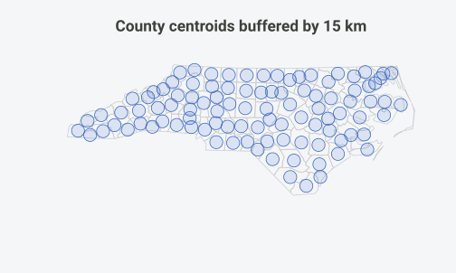
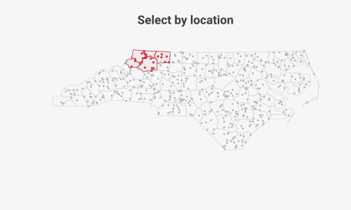
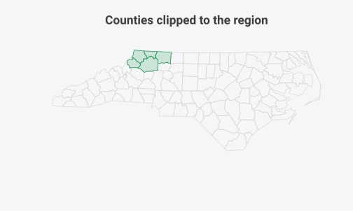
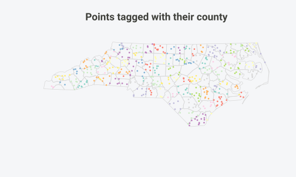
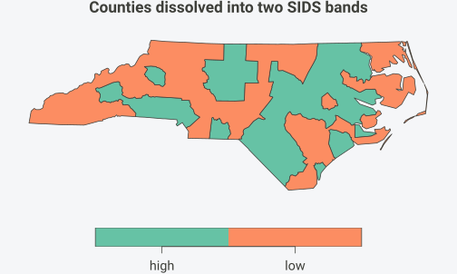
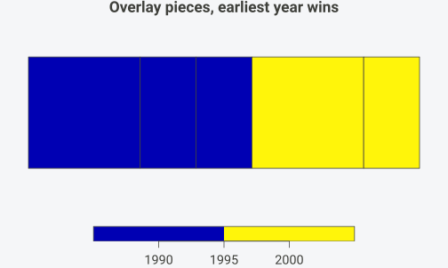

# Streaming spatial operations

This vignette is the hands-on companion to [Out-of-core GIS with
vectra](https://gillescolling.com/vectra/articles/spatial.md). That
article lays out the cost model; this one runs the streaming vector
verbs end to end on a real layer, so every block below is code you can
execute and check. It needs the optional
[sf](https://r-spatial.github.io/sf/) package, which the spatial verbs
use to take layers and coordinate reference systems as arguments, and
which runs the operations vectra has no native path for.

Installation is covered in [Get
started](https://gillescolling.com/vectra/articles/quickstart.md).

``` r

library(vectra)
library(sf)
#> Warning: package 'sf' was built under R version 4.6.1
```

## The problem

A desktop GIS holds one layer in memory, runs a tool, and writes the
result. That model breaks the moment the working layer is bigger than
RAM: a national occurrence set, a continental road network, every parcel
in a country. The geometry alone runs to tens of gigabytes before any
operation touches it.

vectra keeps the same toolbox but changes what stays resident. A query
is pulled through the C engine in fixed-size batches; each spatial step
works on the batch in front of it and spills the transformed batch back
to disk as a fresh lazy node. Peak memory is one batch plus whatever
small layer the step compares against, so a billion-row layer flows past
a fixed budget. The verbs in this vignette are that streaming envelope:
[`spatial_map()`](https://gillescolling.com/vectra/reference/spatial_map.md),
[`spatial_filter()`](https://gillescolling.com/vectra/reference/spatial_filter.md),
[`spatial_clip()`](https://gillescolling.com/vectra/reference/spatial_clip.md),
[`spatial_join()`](https://gillescolling.com/vectra/reference/spatial_join.md),
[`spatial_dissolve()`](https://gillescolling.com/vectra/reference/spatial_dissolve.md),
[`spatial_overlay()`](https://gillescolling.com/vectra/reference/spatial_overlay.md),
and
[`rasterize()`](https://gillescolling.com/vectra/reference/rasterize.md).

## How geometry travels

vectra has no geometry type. A geometry rides through the engine as
hex-encoded WKB in an ordinary string column, and the coordinate
reference system is carried on the returned node rather than written
into the `.vtr` file. The geometry algorithms come from GEOS. For the
operations vectra recognises (the common predicates, clipping,
buffering, measures and the like on planar data) it calls the GEOS C API
directly, through the [libgeos](https://paleolimbot.github.io/libgeos/)
package it links against, and works straight off the WKB column in C.
Everything else, such as an arbitrary function passed to
[`spatial_map()`](https://gillescolling.com/vectra/reference/spatial_map.md)
or geographic data with spherical geometry switched on, runs through sf
batch by batch.

On that sf path, one streamed step is a loop. Pull a batch, decode its
WKB column into an `sf` object, run the operation, encode the result
back into a WKB string column, and append it to a run-file. When the
loop finishes, the run-files become a single lazy node you can carry on
querying. The memory a run holds is

    peak  =  one batch  +  the resident comparison layer

independent of how many batches stream past. The batch size for the
spill is `flush_rows` (default 500,000 transformed rows); the resident
layer is the small `y` a join or filter tests against.

To make the examples concrete, load the North Carolina counties shipped
with sf and project them to the state plane in metres. Projecting
matters here: in a planar CRS distances, areas, and buffers are
Euclidean, and the recognised operations run natively on the GEOS C API
straight off the WKB column instead of decoding each batch back to `sf`.

``` r

nc <- st_read(system.file("shape/nc.shp", package = "sf"), quiet = TRUE)
nc <- st_transform(nc, 32119)        # NAD83 / North Carolina, metres
crs_nc <- st_crs(nc)
nrow(nc)
#> [1] 100
```

Write the polygons to a `.vtr` file with their geometry as a hex-WKB
column. This is the shape every streamed layer takes: attribute columns
plus one string column of WKB. In a real out-of-core workflow this file
would be written once from a large source and reused; here it is 100
counties standing in for the billion-row case.

``` r

f_poly <- tempfile(fileext = ".vtr")
write_vtr(data.frame(
  NAME  = nc$NAME,
  BIR74 = nc$BIR74,
  SID74 = nc$SID74,
  geometry = st_as_binary(st_geometry(nc), hex = TRUE)
), f_poly)
```

`tbl(f_poly)` now opens a lazy node over that file. Nothing is read
until a verb pulls it. Two functions bring a streamed result back to R:
[`collect()`](https://gillescolling.com/vectra/reference/collect.md)
returns the underlying data.frame, geometry still a WKB string;
[`collect()`](https://gillescolling.com/vectra/reference/collect.md)
decodes that string and reattaches the node’s CRS, giving an ordinary
`sf` object ready to plot or hand to any sf function.

## Per-feature transforms with spatial_map

The widest door is
[`spatial_map()`](https://gillescolling.com/vectra/reference/spatial_map.md):
apply any per-feature sf operation to a streamed layer one batch at a
time. Buffering, simplifying, computing centroids, reprojecting,
extracting coordinates, measuring area. The function you pass takes one
`sf` batch and returns an `sf` object, an `sfc`, or a plain data.frame.
The active geometry of the return becomes the streamed geometry.

Buffer every county centroid by 15 km. The first step builds a centroid
layer on disk, the second streams a buffer over it.

``` r

cent <- tempfile(fileext = ".vtr")
write_vtr(data.frame(
  NAME = nc$NAME,
  geometry = st_as_binary(st_centroid(st_geometry(nc)), hex = TRUE)
), cent)

buffered <- tbl(cent) |>
  spatial_map(~ st_buffer(.x, 15000), crs = crs_nc)
buffered
#> vectra query node
#> Columns (2):
#>   NAME <string>
#>   geometry <string>
```

`buffered` is a lazy node, not a materialized layer: the buffer has not
run yet.
[`collect()`](https://gillescolling.com/vectra/reference/collect.md)
pulls it through and decodes the geometry.

``` r

b_sf <- collect(buffered)
plot(st_geometry(nc), border = "grey80", col = NA,
     main = "County centroids buffered by 15 km")
plot(st_geometry(b_sf), border = "#3366cc", col = "#3366cc22", add = TRUE)
```



The formula syntax (`~ st_buffer(.x, 15000)`) is rlang’s: `.x` is the
batch. A named function works identically and is clearer for anything
longer than one call. The return can also be a plain data.frame rather
than a geometry, which turns the spatial step into a streamed
feature-summary with the geometry dropped. That is the way to compute
per-feature area over a layer too large to hold whole.

``` r

areas <- tbl(f_poly) |>
  spatial_map(~ data.frame(NAME = .x$NAME,
                           area_km2 = as.numeric(st_area(.x)) / 1e6),
              crs = crs_nc)
head(collect(areas))
#>          NAME  area_km2
#> 1        Ashe 1137.5901
#> 2   Alleghany  611.1970
#> 3       Surry 1423.7288
#> 4   Currituck  694.6611
#> 5 Northampton 1520.9918
#> 6    Hertford  967.8553
```

Because the result is a node, it chains. A buffer feeding a filter
feeding a join is three streamed steps, each spilling to its own
run-files, with the CRS carried forward so you state it once.
`flush_rows` controls the spill batch: raise it for fewer, larger
temporary files when rows are small, lower it when a single feature’s
geometry is heavy. The default of 500,000 suits point and small-polygon
work.

## Smooth geometry with spatial_smooth

[`spatial_smooth()`](https://gillescolling.com/vectra/reference/spatial_smooth.md)
rounds the corners of every line and polygon by Chaikin corner-cutting,
one batch at a time. Each pass replaces a vertex with two points along
its adjacent edges, so sharp angles become a smooth curve; more
`iterations` give a smoother result with more vertices. It is computed
directly on the coordinates with no GEOS call, and open lines keep their
endpoints.

``` r

zig <- st_linestring(rbind(c(0, 0), c(1, 1), c(2, 0), c(3, 1), c(4, 0)))
f_zig <- tempfile(fileext = ".vtr")
write_vtr(data.frame(
  id = 1L, geometry = st_as_binary(st_sfc(zig), hex = TRUE)), f_zig)

tbl(f_zig) |> spatial_smooth(iterations = 3) |> collect()
#> Simple feature collection with 1 feature and 1 field
#> Geometry type: LINESTRING
#> Dimension:     XY
#> Bounding box:  xmin: 0 ymin: 0 xmax: 4 ymax: 0.75
#> CRS:           NA
#>   id                       geometry
#> 1  1 LINESTRING (0 0, 0.015625 0...
unlink(f_zig)
```

## Select by location with spatial_filter

The most-used vector tool keeps the features standing in a spatial
relation to another layer: points inside a study region, parcels
touching a road, patches within a buffer of the coast.
[`spatial_filter()`](https://gillescolling.com/vectra/reference/spatial_filter.md)
streams the large layer and tests each batch against a small resident
layer with an sf predicate, keeping or dropping whole features. It is
the spatial counterpart to
[`semi_join()`](https://gillescolling.com/vectra/reference/left_join.md):
rows are filtered, never duplicated, and no columns are added, so the
output carries the input schema unchanged.

Sample 500 points across the state and store them as plain x/y columns.
Point input as coordinate columns is the headline case and the fully
sf-free path: each point is built in C and matched against the resident
layer’s spatial index with no per-batch round-trip through sf.

``` r

set.seed(1)
pts <- st_coordinates(st_sample(st_union(nc), 500))
fp <- tempfile(fileext = ".vtr")
write_vtr(data.frame(id = seq_len(nrow(pts)), x = pts[, 1], y = pts[, 2]), fp)
```

Keep the points falling inside a five-county region in the northwest.

``` r

region <- nc[nc$NAME %in% c("Ashe", "Alleghany", "Surry", "Wilkes", "Watauga"),
             "NAME"]

keep_xy <- tbl(fp) |>
  spatial_filter(region, coords = c("x", "y"), crs = crs_nc) |>
  collect()
nrow(keep_xy)
#> [1] 25
```

Twenty-five of the 500 points land in the region. Plot the kept points
against the dropped ones.

``` r

plot(st_geometry(nc), border = "grey85", col = NA, main = "Select by location")
plot(st_geometry(region), border = "#cc3344", col = "#cc334411", add = TRUE)
points(pts, pch = 16, cex = 0.5, col = "grey70")
points(keep_xy$x, keep_xy$y, pch = 16, cex = 0.6, col = "#cc3344")
```



`negate = TRUE` inverts the test, keeping the 475 points outside the
region. A different `predicate` changes the relation: `st_within`,
`st_covered_by`, `st_touches`, `st_crosses`, and the rest of the sf
binary predicates are all accepted. `st_is_within_distance` takes its
radius through `dist`, in CRS units, and keeps every feature within that
distance of the layer.

``` r

near <- tbl(fp) |>
  spatial_filter(region, predicate = st_is_within_distance,
                 coords = c("x", "y"), crs = crs_nc, dist = 30000)
nrow(collect(near))
#> [1] 60
```

Sixty points sit within 30 km of the region, more than the 25 strictly
inside. For the recognised predicates on planar data the test runs in C
off the WKB column or the raw coordinates; an unrecognised predicate,
geographic data with spherical geometry switched on, or an extra
predicate argument falls back to the per-batch sf loop, which preserves
sf’s exact semantics at the cost of decoding each batch.

## Cut geometry with spatial_clip

[`spatial_filter()`](https://gillescolling.com/vectra/reference/spatial_filter.md)
keeps or drops whole features;
[`spatial_clip()`](https://gillescolling.com/vectra/reference/spatial_clip.md)
cuts their geometry along a mask. Clipping intersects each batch with
the mask and keeps the part inside it, the streamed equivalent of
[`st_intersection()`](https://r-spatial.github.io/sf/reference/geos_binary_ops.html)
against a fixed boundary. `erase = TRUE` keeps the part outside instead.

``` r

mask_region <- st_union(st_geometry(region))

clipped <- tbl(f_poly) |> spatial_clip(mask_region, crs = crs_nc)
c_sf <- collect(clipped)
nrow(c_sf)
#> [1] 12
```

Twelve counties have area inside the region’s bounding shape, and each
comes back trimmed to the part that overlaps it. Plot the clipped
slivers over the full state.

``` r

plot(st_geometry(nc), border = "grey85", col = NA,
     main = "Counties clipped to the region")
plot(st_geometry(c_sf), border = "#2a9d5c", col = "#2a9d5c33", add = TRUE)
```



The mask is unioned once into a single resident geometry, then each
batch is cut against it in C. As with the join and filter, the cut runs
natively on the WKB column for planar data and through
[`st_intersection()`](https://r-spatial.github.io/sf/reference/geos_binary_ops.html)
/
[`st_difference()`](https://r-spatial.github.io/sf/reference/geos_binary_ops.html)
for the geographic-with-s2 and coordinate-assembled cases. Erase
reverses the keep:
`tbl(f_poly) |> spatial_clip(mask_region, erase = TRUE)` returns the 95
counties with any area outside the region, each trimmed to that outside
part.

## Split geometry with spatial_split

[`spatial_split()`](https://gillescolling.com/vectra/reference/spatial_split.md)
cuts each feature against a small resident `blade` layer, the QGIS
“split with lines”. A polygon is divided into the faces the blade carves
out, a line into the arcs between crossings, and each piece is emitted
as its own row with the source attributes copied. A feature the blade
does not cross passes through whole. With `extract = "points"` the verb
returns the crossing points instead.

``` r

square <- st_polygon(list(rbind(c(0, 0), c(4, 0), c(4, 4), c(0, 4), c(0, 0))))
blade  <- st_sfc(st_linestring(rbind(c(2, -1), c(2, 5))))

f_sq <- tempfile(fileext = ".vtr")
write_vtr(data.frame(
  id = 1L, geometry = st_as_binary(st_sfc(square), hex = TRUE)), f_sq)

tbl(f_sq) |> spatial_split(blade) |> collect()
#> Simple feature collection with 2 features and 1 field
#> Geometry type: POLYGON
#> Dimension:     XY
#> Bounding box:  xmin: 0 ymin: 0 xmax: 4 ymax: 4
#> CRS:           NA
#>   id                       geometry
#> 1  1 POLYGON ((2 0, 0 0, 0 4, 2 ...
#> 2  1 POLYGON ((2 4, 4 4, 4 0, 2 ...
unlink(f_sq)
```

## Tag features with spatial_join

To attach a layer’s attributes rather than filter or cut,
[`spatial_join()`](https://gillescolling.com/vectra/reference/spatial_join.md)
streams the large left side and joins each batch against a small
resident right side. The dominant workload is tagging a huge point set
with the polygon it falls in: which county each occurrence sits in,
which census tract each address belongs to. The billion-row left stream
never materializes while the polygon layer stays in RAM. On the native
path the join is a lazy node like any other verb: the joined rows stream
straight into whatever comes next, a
[`count()`](https://gillescolling.com/vectra/reference/count.md) or a
[`write_vtr()`](https://gillescolling.com/vectra/reference/write_vtr.md),
without being spilled first.

``` r

tagged <- tbl(fp) |>
  spatial_join(nc["NAME"], coords = c("x", "y"), crs = crs_nc)
tdf <- collect(tagged)
head(tdf[, c("id", "NAME")])
#> Simple feature collection with 6 features and 2 fields
#> Geometry type: POINT
#> Dimension:     XY
#> Bounding box:  xmin: 585944.2 ymin: 22100.77 xmax: 856470.9 ymax: 285752.2
#> Projected CRS: NAD83 / North Carolina
#>   id       NAME                  geometry
#> 1  1       Hoke POINT (585944.2 123589.7)
#> 2  2 Pasquotank POINT (856470.9 285752.2)
#> 3  3    Tyrrell POINT (848550.7 237041.2)
#> 4  4   Johnston   POINT (656888 178574.5)
#> 5  5 Cumberland POINT (631329.1 146405.6)
#> 6  6  Brunswick POINT (678043.5 22100.77)
```

Every point now carries the `NAME` of its county. The default predicate
is `st_intersects` and the default is a left join, so an unmatched left
row is kept once with NA in the right columns; `left = FALSE` drops the
unmatched rows for an inner join. Colour the points by the county they
were tagged with.

``` r

tagged_sf <- st_as_sf(tdf, coords = c("x", "y"), crs = crs_nc)
plot(st_geometry(nc), border = "grey85", col = NA,
     main = "Points tagged with their county")
plot(tagged_sf["NAME"], pch = 16, cex = 0.5, add = TRUE)
```



When only the attributes matter, `keep_geom = FALSE` drops the left
geometry column. With `coords =` the point geometries are then never
built at all, which is the cheap way to tag points and aggregate:

``` r

tbl(fp) |>
  spatial_join(nc["NAME"], coords = c("x", "y"), crs = crs_nc,
               keep_geom = FALSE) |>
  count(NAME) |>
  collect() |>
  head()
#>        NAME n
#> 1  Alamance 2
#> 2 Alexander 6
#> 3 Alleghany 4
#> 4     Anson 4
#> 5      Ashe 5
#> 6     Avery 4
```

Columns present on both sides are disambiguated with `suffix` (default
`c(".x", ".y")`), exactly as
[`st_join()`](https://r-spatial.github.io/sf/reference/st_join.html)
does. A different `join` predicate changes the relation;
`st_nearest_feature` finds the closest right feature to each left one,
which is how you snap points to the nearest road or station.

``` r

ncent <- st_sf(NAME = nc$NAME, geometry = st_centroid(st_geometry(nc)))
nearest <- tbl(fp) |>
  spatial_join(ncent, join = st_nearest_feature,
               coords = c("x", "y"), crs = crs_nc)
nrow(collect(nearest))
#> [1] 500
```

### When both sides are larger than RAM

The resident-`y` path assumes the right side fits in memory. When it
does not, pass `partition = grid(cellsize)` and a streamed `vectra_node`
as `y`. Both inputs are binned to a uniform grid and joined one shard at
a time, so neither side is ever fully resident. A coordinate maps to the
cell

    cell  =  floor( (coord - origin) / cellsize )

per axis. Each left feature is assigned to the single cell of its
reference point; each right feature is replicated to every cell its
bounding box overlaps. A left row is therefore emitted exactly once, and
the result equals the resident join for point left geometry.

``` r

g_poly <- tempfile(fileext = ".vtr")
write_vtr(data.frame(
  NAME = nc$NAME,
  geometry = st_as_binary(st_geometry(nc), hex = TRUE)
), g_poly)

tagged2 <- tbl(fp) |>
  spatial_join(tbl(g_poly), coords = c("x", "y"), crs = crs_nc,
               partition = grid(80000))
t2 <- collect(tagged2)
sum(!is.na(t2$NAME))
#> [1] 500
```

All 500 points are tagged, matching the resident join. The `cellsize` is
the one tuning knob: large enough that one cell’s features fit in
memory, small enough that the shards stay balanced. For point-in-polygon
tagging any cell larger than the polygons works; for an
extended-on-extended join choose it larger than the left features. The
nearest-feature predicate is not local to one cell, so under `partition`
a left point searches its own cell and the eight around it; set
`cellsize` at least as large as the largest expected nearest distance.

### Same answer as resident sf

Streaming changes the memory profile, not the result. The streamed join
returns exactly what
[`st_join()`](https://r-spatial.github.io/sf/reference/st_join.html)
returns on the whole layer held in memory, feature for feature. Run both
on the 500-point set and compare.

``` r

streamed <- collect(
  tbl(fp) |> spatial_join(nc["NAME"], coords = c("x", "y"), crs = crs_nc))

resident <- st_join(
  st_as_sf(collect(tbl(fp)), coords = c("x", "y"), crs = crs_nc, remove = FALSE),
  nc["NAME"], join = st_intersects)

all.equal(streamed$NAME[order(streamed$id)],
          resident$NAME[order(resident$id)])
#> [1] TRUE
```

The county tags match for every point. The equality is the contract: a
streamed verb is the resident sf call run batch by batch, so the choice
between them is a memory decision, not an accuracy trade-off.

### At scale

The point of streaming shows when the layer stops fitting in memory.
Scatter 200,000 points across the state’s bounding box and filter them
to the five-county region. Only one batch is resident at a time, so the
same code that ran on 500 points runs on 200,000 with a flat memory
profile.

``` r

set.seed(42)
bb <- st_bbox(nc)
n_big <- 2e5
big <- data.frame(id = seq_len(n_big),
                  x = runif(n_big, bb["xmin"], bb["xmax"]),
                  y = runif(n_big, bb["ymin"], bb["ymax"]))
fbig <- tempfile(fileext = ".vtr")
write_vtr(big, fbig)

kept <- tbl(fbig) |>
  spatial_filter(region, coords = c("x", "y"), crs = crs_nc) |>
  collect()
nrow(kept)
#> [1] 4759
```

A few thousand of the 200,000 land in the five counties. At a billion
points the file would be larger but the resident set would not grow: the
engine still pulls one batch, tests it in C against the region’s spatial
index, and moves on. That is the whole proposition. The operation that a
desktop GIS can only run on a layer it can open is the same operation,
run past a fixed memory budget.

## Nearest features with spatial_knn

Where
[`spatial_join()`](https://gillescolling.com/vectra/reference/spatial_join.md)
attaches the single nearest feature,
[`spatial_knn()`](https://gillescolling.com/vectra/reference/spatial_knn.md)
returns the `k` nearest features per streamed point, one row per pair,
each with the rank (1 is nearest) and the distance. The candidate layer
`y` is held resident while the points stream.

``` r

towns <- suppressWarnings(st_centroid(st_geometry(nc)))[1:5]
towns <- st_sf(town = nc$NAME[1:5], geometry = towns)

set.seed(1)
pts <- suppressWarnings(st_coordinates(st_sample(nc, 100)))
f_pts <- tempfile(fileext = ".vtr")
write_vtr(data.frame(id = seq_len(nrow(pts)), x = pts[, 1], y = pts[, 2]), f_pts)

tbl(f_pts) |>
  spatial_knn(towns, k = 2, coords = c("x", "y"), crs = crs_nc, y_id = "town") |>
  collect() |> head()
#> Simple feature collection with 6 features and 6 fields
#> Geometry type: POINT
#> Dimension:     XY
#> Bounding box:  xmin: 585944.2 ymin: 81102.29 xmax: 656888 ymax: 193988.2
#> Projected CRS: NAD83 / North Carolina
#>   id        x         y rank    neighbor distance                  geometry
#> 1  1 585944.2 193988.16    1       Surry 163726.1 POINT (585944.2 193988.2)
#> 2  1 585944.2 193988.16    2 Northampton 195894.6 POINT (585944.2 193988.2)
#> 3  2 656888.0  95932.95    1 Northampton 223065.3   POINT (656888 95932.95)
#> 4  2 656888.0  95932.95    2       Surry 282285.8   POINT (656888 95932.95)
#> 5  3 631329.1  81102.29    1 Northampton 247961.5 POINT (631329.1 81102.29)
#> 6  3 631329.1  81102.29    2       Surry 276346.2 POINT (631329.1 81102.29)
unlink(f_pts)
```

## Merge geometries with spatial_dissolve

Dissolve unions the geometries within each group into one feature, the
GIS “Dissolve” tool: counties into states, parcels into ownership
blocks. Unlike the per-batch verbs, it needs every geometry of a group
together to union them, so it rides a different tier. The input is
spilled once and routed into one disjoint shard per group in a single
bounded pass; each shard is then read back and unioned. Peak memory is
the routing budget during the pass, then one group’s geometries while
that group unions. Partition on a key whose groups fit in memory.

Split the counties into two bands by their 1974 SIDS count and merge
each band into a single feature, summing births along the way.

``` r

nc$band <- ifelse(nc$SID74 > 5, "high", "low")
fb <- tempfile(fileext = ".vtr")
write_vtr(data.frame(
  band = nc$band, BIR74 = nc$BIR74,
  geometry = st_as_binary(st_geometry(nc), hex = TRUE)
), fb)

merged <- tbl(fb) |>
  spatial_dissolve(by = "band", crs = crs_nc,
                   .fun = list(births = function(d) sum(d$BIR74)))
m_sf <- collect(merged)
m_sf
#> Simple feature collection with 2 features and 2 fields
#> Geometry type: MULTIPOLYGON
#> Dimension:     XY
#> Bounding box:  xmin: 123829.8 ymin: 14740.06 xmax: 930518.6 ymax: 318255.5
#> Projected CRS: NAD83 / North Carolina
#>   band births                       geometry
#> 1 high 227613 MULTIPOLYGON (((568618.4 96...
#> 2  low 102349 MULTIPOLYGON (((281152.8 19...
```

Two features come back, one per band, each carrying the summed `births`
of its counties. The `.fun` argument is a named list of summaries; each
function takes the group’s data.frame and returns one value, and the
list name becomes the output column. Plot the two bands.

``` r

plot(m_sf["band"], main = "Counties dissolved into two SIDS bands")
```



With no `by`, the whole layer dissolves into one feature, which is the
fast way to compute a layer’s outline out of core. On planar data each
group is unioned natively off the WKB column; geographic data with s2
on, or an extra
[`st_union()`](https://r-spatial.github.io/sf/reference/geos_combine.html)
argument such as `is_coverage = TRUE`, unions through sf instead.

## Split overlaps apart with spatial_overlay

Dissolve merges overlapping geometry; overlay splits it.
[`spatial_overlay()`](https://gillescolling.com/vectra/reference/spatial_overlay.md)
takes a polygon layer that overlaps itself and cuts it along every
overlap into disjoint pieces, returning one row per piece per covering
polygon. Where `k` polygons overlap, that piece appears `k` times, each
row carrying one source polygon’s attributes. This is the operation a
GIS exposes as “Union (single layer)”: the overlap is retained once per
contributing feature rather than dissolved away. It answers questions
like “which protected areas, designated in which years, cover this exact
patch of sea”.

Three overlapping squares designated in different years make the
smallest meaningful example.

``` r

sq <- function(a, b) st_polygon(list(rbind(
  c(a, 0), c(b, 0), c(b, 1), c(a, 1), c(a, 0))))
polys <- st_sf(year = c(1990L, 2010L, 2000L),
               geometry = st_sfc(sq(0, 2), sq(1, 3), sq(1.5, 3.5)))

pieces <- collect(spatial_overlay(polys))
nrow(pieces)
#> [1] 9
length(unique(pieces$piece_id))
#> [1] 5
```

The three squares decompose into five disjoint pieces, returned as nine
rows because the overlapping pieces are repeated once per covering
square. The `piece_id` column keys the pieces: rows sharing an id are
the same patch of ground seen from different source polygons. Resolve
the duplication with a grouped slice. Earliest designation year wins:

``` r

first <- spatial_overlay(polys) |>
  group_by(piece_id) |>
  slice_min(year, n = 1, with_ties = FALSE) |>
  collect()
nrow(first)
#> [1] 5

plot(first["year"], main = "Overlay pieces, earliest year wins")
```



Five pieces remain, one per disjoint patch, each labelled with the
earliest year that covers it. Swapping `slice_min` for `slice_max` gives
the latest; any grouped reduction works, because the pieces are an
ordinary streamed node by this point.

Three properties make the overlay trustworthy on real data. First,
correctness is checked, not assumed: for a valid decomposition the piece
areas covering an input must sum to that input’s area, and the engine
verifies this invariant per batch, warning if coverage drifts past a
relative `1e-4` rather than returning silently wrong. Second, memory is
bounded by tiling: a connected cluster of many large overlapping
polygons can node into far more linework than the input, so clusters too
large for the budget are tiled over their own extent and clipped, with
each feature cleaned exactly once. Third, the snapping grid is explicit:
coordinates are snapped to a grid derived from their magnitude so the
near-duplicate boundaries that overlapping polygons share coincide,
which is what keeps the pieces disjoint instead of leaving sliver faces.

Unlike the other verbs,
[`spatial_overlay()`](https://gillescolling.com/vectra/reference/spatial_overlay.md)
takes a resident `sf` object, not a lazy node: building the overlap
graph needs the geometries in memory. The exploded result, typically
several times larger than the input, is what streams to disk.
`mem_limit` caps the peak working set and `threads` sets the parallel
overlay width; raise both for speed on a big machine, lower `mem_limit`
for tighter memory.

### A second layer

Passing a second layer `y` nodes two layers into one planar partition
and carries the attributes of the covering `x`-record and `y`-record
onto each piece. A `how` argument selects which pieces to keep:
`"intersection"` (covered by both, the default), `"union"` (every piece
of either, the absent side filled with `NA`), `"identity"` (all of `x`
split by `y`), or `"symdiff"` (pieces in exactly one layer).

``` r

zones <- st_sf(zone = c("A", "B"),
               geometry = st_sfc(sq(0, 1.5), sq(1.5, 3)))

inter <- spatial_overlay(polys, zones, how = "intersection") |> collect()
inter
#> Simple feature collection with 8 features and 3 fields
#> Geometry type: POLYGON
#> Dimension:     XY
#> Bounding box:  xmin: 0 ymin: 0 xmax: 3 ymax: 1
#> CRS:           NA
#>   year zone piece_id                       geometry
#> 1 1990    A        1 POLYGON ((0 1, 1 1, 1 0, 0 ...
#> 2 1990    A        2 POLYGON ((1 1, 1.5 1, 1.5 0...
#> 3 2010    A        2 POLYGON ((1 1, 1.5 1, 1.5 0...
#> 4 1990    B        3 POLYGON ((1.5 1, 2 1, 2 0, ...
#> 5 2000    B        3 POLYGON ((1.5 1, 2 1, 2 0, ...
#> 6 2010    B        3 POLYGON ((1.5 1, 2 1, 2 0, ...
#> 7 2010    B        4 POLYGON ((2 0, 2 1, 3 1, 3 ...
#> 8 2000    B        4 POLYGON ((2 0, 2 1, 3 1, 3 ...
```

Each piece now carries both its `year` (from the squares) and its `zone`
(from the zone layer). `vars_y` narrows the carried `y` columns, and a
name shared with an `x` column is disambiguated with a `.x` / `.y`
suffix. A file-path `y` is read in batches with `layer_y` / `query_y`,
the same way `x` is.

## Materializing and round-tripping

Three exits bring a streamed result out.
[`collect()`](https://gillescolling.com/vectra/reference/collect.md)
returns the data.frame with geometry still a WKB string, useful when the
next step is a non-spatial verb or another `.vtr` write.
[`collect()`](https://gillescolling.com/vectra/reference/collect.md)
decodes the WKB and reattaches the node’s CRS, giving an `sf` object.
[`write_vtr()`](https://gillescolling.com/vectra/reference/write_vtr.md)
on a node streams the result straight to a new `.vtr` file without ever
holding it whole, so a multi-step spatial pipeline can land its output
on disk under the same fixed memory budget it ran in.

``` r

out <- tempfile(fileext = ".vtr")
tbl(fp) |>
  spatial_filter(region, coords = c("x", "y"), crs = crs_nc) |>
  write_vtr(out)
nrow(collect(tbl(out)))
#> [1] 25
```

The CRS lives on the node, not in the file. A pipeline that opens
projected data, maps, filters, and joins keeps the projection because
each verb carries it forward; you state `crs =` once at the first step
that needs it, or let it inherit from the upstream node. The `.vtr` file
itself stores only the WKB bytes, so reopening a written file and
calling
[`collect()`](https://gillescolling.com/vectra/reference/collect.md)
needs the CRS supplied again if you want it labelled.

## Geometry functions in expressions

vectra carries geometry through the engine as hex-encoded WKB in an
ordinary string column. The verbs above wrap whole sf operations around
that column. This section covers the other half of the spatial surface:
a family of `st_*` functions that work inside the expression verbs
themselves, so a measure, a predicate, or a geometry transform is just
another term in
[`mutate()`](https://gillescolling.com/vectra/reference/mutate.md),
[`filter()`](https://gillescolling.com/vectra/reference/filter.md), or
[`summarise()`](https://gillescolling.com/vectra/reference/summarise.md).

These functions run on the GEOS C library straight off the WKB column,
one row at a time, with no per-batch round-trip through sf.
`filter(st_area(geometry) > 1e6)` prunes the stream in C, and
`mutate(here = st_centroid(geometry))` adds a new WKB geometry column
that any later verb can read. The per-row decode is parallelised with
OpenMP, so a measure over a large layer uses every core.

### A layer to work on

The examples use the North Carolina counties shipped with sf. Writing
the layer to a `.vtr` is the usual first step: the geometry becomes a
hex-WKB string column (named `geometry` by convention), and the
attributes ride alongside it.

``` r

nc <- st_read(system.file("shape/nc.shp", package = "sf"), quiet = TRUE)

f <- tempfile(fileext = ".vtr")
write_vtr(data.frame(
  NAME     = nc$NAME,
  BIR74    = nc$BIR74,
  geometry = st_as_binary(st_geometry(nc), hex = TRUE)
), f)

tbl(f)
#> vectra query node
#> Columns (3):
#>   NAME <string>
#>   BIR74 <double>
#>   geometry <string>
```

The counties are stored in longitude and latitude, so every measure
below is planar in those units, the same convention the streaming verbs
follow. Project the layer first if you need metric areas or distances.

### Measures

A measure reads a geometry and returns a number, so it drops into
[`mutate()`](https://gillescolling.com/vectra/reference/mutate.md) as an
ordinary column.

``` r

tbl(f) |>
  mutate(area   = st_area(geometry),
         perim  = st_perimeter(geometry),
         nverts = st_npoints(geometry)) |>
  select(NAME, area, perim, nverts) |>
  collect() |>
  head()
#>          NAME       area    perim nverts
#> 1        Ashe 0.11428350 1.442087     27
#> 2   Alleghany 0.06139976 1.231197     26
#> 3       Surry 0.14301628 1.630283     28
#> 4   Currituck 0.06977098 2.967975     38
#> 5 Northampton 0.15275930 2.206482     34
#> 6    Hertford 0.09715756 1.669527     22
```

[`st_length()`](https://r-spatial.github.io/sf/reference/geos_measures.html)
returns the boundary length of a polygon (an alias of
[`st_perimeter()`](https://r-spatial.github.io/sf/reference/geos_measures.html))
and the line length of a linestring. `st_ngeometries()` counts the parts
of a multi-geometry. `st_x()` and `st_y()` read the coordinate of a
point and return `NA` for anything that is not a point, which makes them
most useful on a centroid:

``` r

tbl(f) |>
  mutate(centroid = st_centroid(geometry),
         cx = st_x(centroid),
         cy = st_y(centroid)) |>
  select(NAME, cx, cy) |>
  collect() |>
  head()
#>          NAME        cx       cy
#> 1        Ashe -81.49826 36.43140
#> 2   Alleghany -81.12515 36.49101
#> 3       Surry -80.68575 36.41252
#> 4   Currituck -76.02750 36.40728
#> 5 Northampton -77.41056 36.42228
#> 6    Hertford -76.99478 36.36145
```

A geometry-valued function such as
[`st_centroid()`](https://r-spatial.github.io/sf/reference/geos_unary.html)
produces a new WKB column (`centroid` above), and the next term reads it
like any other column. That is the whole mechanism: geometry in,
geometry or a scalar out, all as columns.

### Predicates

A unary predicate tests one geometry:
[`st_is_valid()`](https://r-spatial.github.io/sf/reference/valid.html),
[`st_is_empty()`](https://r-spatial.github.io/sf/reference/geos_query.html),
[`st_is_simple()`](https://r-spatial.github.io/sf/reference/geos_query.html).
A binary predicate tests a topological relation against a second
geometry:
[`st_intersects()`](https://r-spatial.github.io/sf/reference/geos_binary_pred.html),
[`st_within()`](https://r-spatial.github.io/sf/reference/geos_binary_pred.html),
[`st_contains()`](https://r-spatial.github.io/sf/reference/geos_binary_pred.html),
[`st_overlaps()`](https://r-spatial.github.io/sf/reference/geos_binary_pred.html),
[`st_touches()`](https://r-spatial.github.io/sf/reference/geos_binary_pred.html),
[`st_crosses()`](https://r-spatial.github.io/sf/reference/geos_binary_pred.html),
[`st_equals()`](https://r-spatial.github.io/sf/reference/geos_binary_pred.html),
[`st_disjoint()`](https://r-spatial.github.io/sf/reference/geos_binary_pred.html),
[`st_covers()`](https://r-spatial.github.io/sf/reference/geos_binary_pred.html),
[`st_covered_by()`](https://r-spatial.github.io/sf/reference/geos_binary_pred.html).

In [`filter()`](https://gillescolling.com/vectra/reference/filter.md) a
predicate keeps the rows where the relation holds, the
geometry-expression form of select-by-location:

``` r

aoi <- st_as_sfc(st_bbox(c(xmin = -80, ymin = 35, xmax = -78, ymax = 36.5)),
                 crs = st_crs(nc))

tbl(f) |>
  filter(st_intersects(geometry, aoi)) |>
  collect() |>
  nrow()
#> [1] 30
```

The second geometry here is a constant `sf` object. It is parsed once
and shared read-only across every row, so testing a whole stream against
one area of interest stays cheap. A multi-feature object is unioned to a
single geometry first.

In [`mutate()`](https://gillescolling.com/vectra/reference/mutate.md)
the same call returns a logical column, ready for a later verb:

``` r

tbl(f) |>
  mutate(near_raleigh = st_intersects(geometry, aoi)) |>
  filter(near_raleigh) |>
  select(NAME) |>
  collect() |>
  head()
#>         NAME
#> 1     Warren
#> 2    Caswell
#> 3 Rockingham
#> 4  Granville
#> 5     Person
#> 6      Vance
```

### Distance

[`st_distance()`](https://r-spatial.github.io/sf/reference/geos_measures.html)
returns the shortest planar distance to a second geometry, again a
constant or another column:

``` r

raleigh <- st_sfc(st_point(c(-78.64, 35.78)), crs = st_crs(nc))

tbl(f) |>
  mutate(centroid   = st_centroid(geometry),
         d_raleigh  = st_distance(centroid, raleigh)) |>
  select(NAME, d_raleigh) |>
  arrange(d_raleigh) |>
  collect() |>
  head()
#>        NAME  d_raleigh
#> 1      Wake 0.01352946
#> 2    Durham 0.34428008
#> 3  Johnston 0.38179328
#> 4  Franklin 0.46173171
#> 5   Harnett 0.47354352
#> 6 Granville 0.52039217
```

When the second argument is a geometry column instead of a constant, the
distance is computed row by row between the two columns.

### Aggregating a measure

Because a measure is an ordinary numeric column, it aggregates like one.
A grouped
[`summarise()`](https://gillescolling.com/vectra/reference/summarise.md)
over a measure is a zonal total computed entirely in the stream:

``` r

tbl(f) |>
  mutate(area = st_area(geometry)) |>
  summarise(total_area = sum(area), counties = n()) |>
  collect()
#>   total_area counties
#> 1    12.6278      100
```

### Transforms

A transform returns a geometry, so it builds a new WKB column.
Materialise it with
[`collect()`](https://gillescolling.com/vectra/reference/collect.md),
which reads the WKB column back into an `sf` object (point it at the
column with `geom =`, and pass the `crs` the layer was stored in).

``` r

hulls <- tbl(f) |>
  mutate(geometry = st_convex_hull(geometry)) |>
  select(NAME, geometry) |>
  collect(geom = "geometry", crs = st_crs(nc))

hulls
#> Simple feature collection with 100 features and 1 field
#> Geometry type: POLYGON
#> Dimension:     XY
#> Bounding box:  xmin: -84.32385 ymin: 33.88199 xmax: -75.45698 ymax: 36.58965
#> Geodetic CRS:  NAD27
#> First 10 features:
#>           NAME                       geometry
#> 1         Ashe POLYGON ((-81.47276 36.2343...
#> 2    Alleghany POLYGON ((-81.23989 36.3653...
#> 3        Surry POLYGON ((-80.87438 36.2338...
#> 4    Currituck POLYGON ((-75.79885 36.0728...
#> 5  Northampton POLYGON ((-77.30948 36.1627...
#> 6     Hertford POLYGON ((-76.98069 36.2302...
#> 7       Camden POLYGON ((-75.98134 36.1697...
#> 8        Gates POLYGON ((-76.68874 36.2945...
#> 9       Warren POLYGON ((-78.00629 36.1959...
#> 10      Stokes POLYGON ((-80.02567 36.2502...
```

The transform set is
[`st_centroid()`](https://r-spatial.github.io/sf/reference/geos_unary.html),
[`st_point_on_surface()`](https://r-spatial.github.io/sf/reference/geos_unary.html)
(a point guaranteed to lie on the geometry),
[`st_boundary()`](https://r-spatial.github.io/sf/reference/geos_unary.html),
`st_envelope()` (the bounding rectangle),
[`st_convex_hull()`](https://r-spatial.github.io/sf/reference/geos_unary.html),
[`st_make_valid()`](https://r-spatial.github.io/sf/reference/valid.html)
(repair an invalid geometry), and two parameterised forms:
`st_buffer(g, dist)` and `st_simplify(g, tol)`. Buffering each county
and reading the areas back:

``` r

tbl(f) |>
  mutate(geometry = st_buffer(geometry, 0.1)) |>
  select(NAME, geometry) |>
  collect(geom = "geometry", crs = st_crs(nc)) |>
  st_area() |>
  head()
#> Units: [m^2]
#> [1] 2843204836 2123154372 3334381567 3098502995 3953811907 2852194601
```

[`st_geometry_type()`](https://r-spatial.github.io/sf/reference/st_geometry_type.html)
returns the GEOS type name (`"Point"`, `"Polygon"`, `"MultiPolygon"`,
and so on) as a string column.

### The second geometry of a binary op

For
[`st_distance()`](https://r-spatial.github.io/sf/reference/geos_measures.html)
and the binary predicates, the second argument can be:

- another geometry column, compared row by row;

- a constant `sf` or `sfc` object, parsed once and reused across the
  stream (a multi-feature object is unioned to one geometry);

- a hex-WKB string.

### Missing geometry

A missing (`NA`) or unparseable geometry, or an operation with no answer
(the coordinate of a non-point, the distance to a missing geometry),
yields `NA` for that row rather than stopping the query:

``` r

g <- tempfile(fileext = ".vtr")
write_vtr(data.frame(
  id = 1:4,
  geometry = c(st_as_binary(st_geometry(nc)[1:3], hex = TRUE), NA)
), g)

tbl(g) |>
  mutate(area = st_area(geometry)) |>
  collect()
#> Simple feature collection with 4 features and 2 fields (with 1 geometry empty)
#> Geometry type: GEOMETRY
#> Dimension:     XY
#> Bounding box:  xmin: -81.74107 ymin: 36.23388 xmax: -80.43531 ymax: 36.58965
#> CRS:           NA
#>   id       area                       geometry
#> 1  1 0.11428350 MULTIPOLYGON (((-81.47276 3...
#> 2  2 0.06139976 MULTIPOLYGON (((-81.23989 3...
#> 3  3 0.14301628 MULTIPOLYGON (((-80.45634 3...
#> 4  4         NA       GEOMETRYCOLLECTION EMPTY
```

### Where this fits

The `st_*` expressions are the scalar, per-row layer of vectra’s spatial
surface. They cover measures, predicates, and the common single-geometry
transforms at the price of a column term, with no sf object built per
batch. For an arbitrary per-feature transform that has no `st_*` form,
reach for
[`spatial_map()`](https://gillescolling.com/vectra/reference/spatial_map.md),
which runs any sf-in, sf-out function over each feature. For
constructions that read a whole feature set at once (dissolves,
overlays, hulls of a group, planar topology), the set-wise `spatial_*`
verbs above and [Coverage and topology](#coverage-and-topology) are the
tools.

## Coverage and topology

The per-feature verbs above treat each geometry on its own. A second
family of verbs reads a whole feature set at once: the constructions and
topology operations that need every feature in a group together, not one
row at a time. These ride a shared partition tier. A `by` argument
routes the layer into one shard per group, each shard is processed as an
independent coverage, and the shards stream so the resident budget is
one group rather than the whole layer.

This section covers building polygons from lines, cleaning a polygon
coverage, decomposing geometry into its parts, set-wise constructions,
and linear referencing. Every block runs on the optional
[sf](https://r-spatial.github.io/sf/) package.

### From lines to polygons

[`spatial_polygonize()`](https://gillescolling.com/vectra/reference/spatial_polygonize.md)
builds the polygonal faces enclosed by a line network, the inverse of
taking polygon boundaries. A group’s lines are unioned and noded, then
the faces of that arrangement are returned, one per row.

``` r

grid <- st_sfc(
  st_linestring(rbind(c(0, 0), c(2, 0))),
  st_linestring(rbind(c(0, 1), c(2, 1))),
  st_linestring(rbind(c(0, 2), c(2, 2))),
  st_linestring(rbind(c(0, 0), c(0, 2))),
  st_linestring(rbind(c(1, 0), c(1, 2))),
  st_linestring(rbind(c(2, 0), c(2, 2))))

f <- tempfile(fileext = ".vtr")
write_vtr(data.frame(geometry = st_as_binary(grid, hex = TRUE)), f)

tbl(f) |> spatial_polygonize() |> collect()
#> Simple feature collection with 4 features and 0 fields
#> Geometry type: POLYGON
#> Dimension:     XY
#> Bounding box:  xmin: 0 ymin: 0 xmax: 2 ymax: 2
#> CRS:           NA
#>                         geometry
#> 1 POLYGON ((1 0, 0 0, 0 1, 1 ...
#> 2 POLYGON ((2 0, 1 0, 1 1, 2 ...
#> 3 POLYGON ((1 1, 0 1, 0 2, 1 ...
#> 4 POLYGON ((2 1, 1 1, 1 2, 2 ...
```

[`spatial_line_merge()`](https://gillescolling.com/vectra/reference/spatial_line_merge.md)
is the line counterpart of a dissolve: it sews segments that meet end to
end into maximal linestrings, one row per chain. Segments meeting at a
junction of degree greater than two stay separate.

``` r

seg <- st_sfc(
  st_linestring(rbind(c(0, 0), c(1, 0))),
  st_linestring(rbind(c(1, 0), c(2, 0))),
  st_linestring(rbind(c(2, 0), c(3, 0))))

g <- tempfile(fileext = ".vtr")
write_vtr(data.frame(geometry = st_as_binary(seg, hex = TRUE)), g)

tbl(g) |> spatial_line_merge() |> collect()
#> Simple feature collection with 1 feature and 0 fields
#> Geometry type: LINESTRING
#> Dimension:     XY
#> Bounding box:  xmin: 0 ymin: 0 xmax: 3 ymax: 0
#> CRS:           NA
#>                         geometry
#> 1 LINESTRING (0 0, 1 0, 2 0, ...
```

### Cleaning a coverage

Real coverages arrive with jittered shared borders, sub-pixel slivers,
and more detail than a map needs. Three verbs clean them while keeping
adjacent polygons edge-matched.

[`spatial_snap_grid()`](https://gillescolling.com/vectra/reference/spatial_snap_grid.md)
rounds coordinates to a regular grid and repairs the result, one batch
at a time. It is the fixed-precision snap-rounding that
[`spatial_overlay()`](https://gillescolling.com/vectra/reference/spatial_overlay.md)
applies internally, exposed as a standalone verb, so a layer can be
pre-noded to a common precision without running a full overlay.

``` r

p <- st_polygon(list(rbind(c(0.04, 0.03), c(1.02, 0.01),
                           c(0.98, 1.03), c(0.01, 0.97), c(0.04, 0.03))))
h <- tempfile(fileext = ".vtr")
write_vtr(data.frame(id = 1L, geometry = st_as_binary(st_sfc(p), hex = TRUE)), h)

tbl(h) |> spatial_snap_grid(0.1) |> collect()
#> Simple feature collection with 1 feature and 1 field
#> Geometry type: POLYGON
#> Dimension:     XY
#> Bounding box:  xmin: 0 ymin: 0 xmax: 1 ymax: 1
#> CRS:           NA
#>   id                       geometry
#> 1  1 POLYGON ((0 1, 1 1, 1 0, 0 ...
```

[`spatial_snap()`](https://gillescolling.com/vectra/reference/spatial_snap.md)
instead pulls a streamed layer onto a resident reference layer: vertices
and edges within `tolerance` of `y` are moved onto it, so two layers
that should share a boundary line up exactly.

``` r

ref  <- st_sfc(st_linestring(rbind(c(0, 0), c(10, 0))))
line <- st_linestring(rbind(c(0, 0.2), c(5, 0.1), c(10, 0.2)))

sn <- tempfile(fileext = ".vtr")
write_vtr(data.frame(id = 1L, geometry = st_as_binary(st_sfc(line), hex = TRUE)), sn)

tbl(sn) |> spatial_snap(ref, tolerance = 0.5) |> collect()
#> Simple feature collection with 1 feature and 1 field
#> Geometry type: LINESTRING
#> Dimension:     XY
#> Bounding box:  xmin: 0 ymin: 0 xmax: 10 ymax: 0.1
#> CRS:           NA
#>   id                      geometry
#> 1  1 LINESTRING (0 0, 5 0.1, 10 0)
```

[`spatial_eliminate()`](https://gillescolling.com/vectra/reference/spatial_eliminate.md)
cleans a polygon coverage by absorbing every feature smaller than
`max_area` into a neighbour, the QGIS “Eliminate”. Each sliver joins the
neighbour it shares the longest border with, or the largest-area
neighbour with `into = "largest_area"`. An area-rooted union-find
collapses chains of slivers so a connected run flows to its single
largest member, whose attributes survive.

``` r

big    <- st_polygon(list(rbind(
  c(0, 0), c(10, 0), c(10, 10), c(0, 10), c(0, 0))))
sliver <- st_polygon(list(rbind(
  c(10, 0), c(10.3, 0), c(10.3, 10), c(10, 10), c(10, 0))))

e <- tempfile(fileext = ".vtr")
write_vtr(data.frame(
  id = c("keep", "sliver"),
  geometry = st_as_binary(st_sfc(big, sliver), hex = TRUE)), e)

tbl(e) |> spatial_eliminate(max_area = 5) |> collect()
#> Simple feature collection with 1 feature and 1 field
#> Geometry type: POLYGON
#> Dimension:     XY
#> Bounding box:  xmin: 0 ymin: 0 xmax: 10.3 ymax: 10
#> CRS:           NA
#>     id                       geometry
#> 1 keep POLYGON ((0 0, 0 10, 10 10,...
```

The thin sliver is gone, absorbed into the square it bordered, and the
survivor keeps the `keep` attributes.

[`spatial_simplify()`](https://gillescolling.com/vectra/reference/spatial_simplify.md)
simplifies a polygon coverage without tearing shared edges. Boundaries
are unioned so a shared border is one line, noded into arcs, each arc
simplified once with its junction endpoints pinned, then re-polygonized.
Adjacent polygons stay edge-matched with no slivers. This is the
topology-preserving simplification a per-feature
`spatial_map(~ sf::st_simplify())` cannot give, because that simplifies
each polygon’s copy of a shared border independently.

``` r

p1 <- st_polygon(list(rbind(
  c(0, 0), c(1, 0), c(1, 0.5), c(1, 1), c(0, 1), c(0, 0))))
p2 <- st_polygon(list(rbind(
  c(1, 0), c(2, 0), c(2, 1), c(1, 1), c(1, 0.5), c(1, 0))))

s <- tempfile(fileext = ".vtr")
write_vtr(data.frame(
  id = c("a", "b"),
  geometry = st_as_binary(st_sfc(p1, p2), hex = TRUE)), s)

tbl(s) |> spatial_simplify(tolerance = 0.6) |> collect()
#> Simple feature collection with 2 features and 1 field
#> Geometry type: POLYGON
#> Dimension:     XY
#> Bounding box:  xmin: 0 ymin: 0 xmax: 2 ymax: 1
#> CRS:           NA
#>   id                       geometry
#> 1  a POLYGON ((1 0, 0 0, 0 1, 1 ...
#> 2  b POLYGON ((1 0, 1 0.5, 1 1, ...
```

### Decomposing geometry

[`spatial_explode()`](https://gillescolling.com/vectra/reference/spatial_explode.md)
splits every multipart geometry into its single-part components, a
`MULTIPOLYGON` into one row per polygon and so on, copying the source
attributes onto each part. An optional `part` argument names a 1-based
part-index column. It is the streaming “multipart to singleparts” tool
and the inverse of
[`spatial_dissolve()`](https://gillescolling.com/vectra/reference/spatial_dissolve.md).

``` r

mp <- st_multipolygon(list(
  list(rbind(c(0, 0), c(1, 0), c(1, 1), c(0, 1), c(0, 0))),
  list(rbind(c(2, 2), c(3, 2), c(3, 3), c(2, 3), c(2, 2)))))

m <- tempfile(fileext = ".vtr")
write_vtr(data.frame(
  id = 1L, geometry = st_as_binary(st_sfc(mp), hex = TRUE)), m)

tbl(m) |> spatial_explode(part = "part_id") |> collect()
#> Simple feature collection with 2 features and 2 fields
#> Geometry type: POLYGON
#> Dimension:     XY
#> Bounding box:  xmin: 0 ymin: 0 xmax: 3 ymax: 3
#> CRS:           NA
#>   id part_id                       geometry
#> 1  1       1 POLYGON ((0 0, 1 0, 1 1, 0 ...
#> 2  1       2 POLYGON ((2 2, 3 2, 3 3, 2 ...
```

[`spatial_topology()`](https://gillescolling.com/vectra/reference/spatial_topology.md)
decomposes a polygon coverage into the arcs of its planar topology. The
unioned boundaries are noded so a shared border becomes one arc, tagged
with the identifiers of the (up to two) polygons on either side: two for
an internal shared edge, one for an outer edge. It is the inverse of
[`spatial_polygonize()`](https://gillescolling.com/vectra/reference/spatial_polygonize.md).

``` r

q1 <- st_polygon(list(rbind(c(0, 0), c(1, 0), c(1, 1), c(0, 1), c(0, 0))))
q2 <- st_polygon(list(rbind(c(1, 0), c(2, 0), c(2, 1), c(1, 1), c(1, 0))))

tp <- tempfile(fileext = ".vtr")
write_vtr(data.frame(
  id = c("a", "b"),
  geometry = st_as_binary(st_sfc(q1, q2), hex = TRUE)), tp)

tbl(tp) |> spatial_topology(id = "id") |> collect()
#> Simple feature collection with 4 features and 2 fields
#> Geometry type: LINESTRING
#> Dimension:     XY
#> Bounding box:  xmin: 0 ymin: 0 xmax: 2 ymax: 1
#> CRS:           NA
#>   face1 face2                       geometry
#> 1     a  <NA>          LINESTRING (0 0, 1 0)
#> 2     a     b          LINESTRING (1 0, 1 1)
#> 3     a  <NA>     LINESTRING (1 1, 0 1, 0 0)
#> 4     b  <NA> LINESTRING (1 0, 2 0, 2 1, ...
```

The shared edge between `a` and `b` appears once, with both face columns
filled; each outer edge appears once with the second face `NA`.

[`spatial_centerline()`](https://gillescolling.com/vectra/reference/spatial_centerline.md)
traces the centerline (medial axis) of each polygon from the Voronoi
diagram of its densified boundary: the Voronoi edges that fall inside
the polygon are its skeleton, merged into maximal lines. `density` sets
the boundary sampling and `prune` drops the short spurs the skeleton
grows toward convex corners. It is the usual approximation for a river
or road centerline from a filled shape; non-polygon geometry passes
through unchanged.

``` r

strip <- st_polygon(list(rbind(
  c(0, 0), c(10, 0), c(10, 2), c(0, 2), c(0, 0))))

cl <- tempfile(fileext = ".vtr")
write_vtr(data.frame(geometry = st_as_binary(st_sfc(strip), hex = TRUE)), cl)

tbl(cl) |> spatial_centerline(density = 0.25, prune = 0.5) |> collect()
#> Simple feature collection with 5 features and 0 fields
#> Geometry type: LINESTRING
#> Dimension:     XY
#> Bounding box:  xmin: 0.125 ymin: 0.125 xmax: 9.875 ymax: 1.875
#> CRS:           NA
#>                         geometry
#> 1 LINESTRING (1 1, 0.875 0.87...
#> 2 LINESTRING (0.125 1.875, 0....
#> 3 LINESTRING (1 1, 1.125 1, 1...
#> 4 LINESTRING (9.875 1.875, 9....
#> 5 LINESTRING (9 1, 9.125 0.87...
```

### Set-wise constructions

[`spatial_construct()`](https://gillescolling.com/vectra/reference/spatial_construct.md)
builds a geometry construction from a whole feature set, the
constructions a per-feature
[`spatial_map()`](https://gillescolling.com/vectra/reference/spatial_map.md)
cannot express. A `kind` argument selects it: `"convex_hull"`,
`"concave_hull"`, `"envelope"`, `"oriented_box"`, `"enclosing_circle"`,
`"inscribed_circle"`, `"pole"` (the pole of inaccessibility, the centre
of the maximum inscribed circle), `"voronoi"`, and `"delaunay"`. A `by`
argument builds one construction per group; the enclosing kinds emit one
feature per group, the tessellations one polygon per cell.

``` r

nc <- st_read(system.file("shape/nc.shp", package = "sf"), quiet = TRUE)
nc$band <- nc$SID74 > 5

n <- tempfile(fileext = ".vtr")
write_vtr(data.frame(
  band = nc$band,
  geometry = st_as_binary(st_geometry(nc), hex = TRUE)), n)

tbl(n) |>
  spatial_construct("convex_hull", by = "band", crs = st_crs(nc)) |>
  collect()
#> Simple feature collection with 2 features and 1 field
#> Geometry type: POLYGON
#> Dimension:     XY
#> Bounding box:  xmin: -84.32385 ymin: 33.88199 xmax: -75.45698 ymax: 36.58965
#> Geodetic CRS:  NAD27
#>    band                       geometry
#> 1 FALSE POLYGON ((-84.32385 34.9890...
#> 2  TRUE POLYGON ((-82.88111 35.6735...
```

A tessellation kind returns one polygon per cell, each carrying the
group’s `by` values:

``` r

xy <- rbind(c(0, 0), c(1, 0), c(1, 1), c(0, 1), c(0.4, 0.6))
cloud <- st_sfc(lapply(seq_len(nrow(xy)), function(i) st_point(xy[i, ])))

v <- tempfile(fileext = ".vtr")
write_vtr(data.frame(geometry = st_as_binary(cloud, hex = TRUE)), v)

tbl(v) |> spatial_construct("voronoi") |> collect()
#> Simple feature collection with 5 features and 0 fields
#> Geometry type: POLYGON
#> Dimension:     XY
#> Bounding box:  xmin: -1 ymin: -1 xmax: 2 ymax: 2
#> CRS:           NA
#>                         geometry
#> 1 POLYGON ((2 2, 2 0.5, 0.9 0...
#> 2 POLYGON ((-1 2, 0.5 2, 0.5 ...
#> 3 POLYGON ((-1 -1, -1 0.5, -0...
#> 4 POLYGON ((0.5 1.1, 0.9 0.5,...
#> 5 POLYGON ((2 -1, 0.5 -1, 0.5...
```

### Linear referencing

[`spatial_locate()`](https://gillescolling.com/vectra/reference/spatial_locate.md)
places streamed points along a resident line layer: each point gets its
nearest line’s identifier, the measure (distance along that line to the
point’s projection), and the perpendicular offset, with an optional
`snap` onto the line. The inverse, a measure back to a point, is
[`sf::st_line_interpolate()`](https://r-spatial.github.io/sf/reference/st_line_project_point.html)
through
[`spatial_map()`](https://gillescolling.com/vectra/reference/spatial_map.md).

``` r

roads <- st_sf(road = c("main", "side"), geometry = st_sfc(
  st_linestring(rbind(c(0, 0), c(10, 0))),
  st_linestring(rbind(c(0, 5), c(0, 15)))))

pts <- data.frame(id = 1:2, x = c(3, 1), y = c(1, 9))
l <- tempfile(fileext = ".vtr")
write_vtr(pts, l)

tbl(l) |>
  spatial_locate(roads, coords = c("x", "y"), y_id = "road") |>
  collect()
#> Simple feature collection with 2 features and 6 fields
#> Geometry type: POINT
#> Dimension:     XY
#> Bounding box:  xmin: 1 ymin: 1 xmax: 3 ymax: 9
#> CRS:           NA
#>   id x y line measure distance    geometry
#> 1  1 3 1 main       3        1 POINT (3 1)
#> 2  2 1 9 side       4        1 POINT (1 9)
```

Point 1 is one unit off `main` at measure 3; point 2 is one unit off
`side` at measure 4. With `snap = TRUE` each point’s geometry is
replaced by its projection onto the matched line.

## Network analysis

A line layer becomes a routable graph when its segments are joined at
their endpoints and weighted by a traversal cost. vectra builds that
graph once and holds it resident in a `vectra_network` object, the
network counterpart of the small resident `sf` layer the streaming verbs
compare against. Origins then stream past the resident graph: each batch
of start points is routed in native C, so a national set of origins
flows past a fixed memory budget while the graph stays in memory.

The graph and the shortest-path solver are pure C, a binary-heap
Dijkstra over a compressed adjacency, with no `igraph` dependency. The
solver parallelises over a batch of origins with OpenMP.

### Building a network

[`spatial_network()`](https://gillescolling.com/vectra/reference/spatial_network.md)
takes a line layer and returns a `vectra_network`. Endpoints are snapped
to shared nodes (exactly coincident by default, or within `tolerance`
CRS units), and each edge is weighted by its geometry length unless a
`weight` column names another cost.

The examples use a small grid of unit streets.

``` r

mk <- function(x1, y1, x2, y2)
  st_linestring(rbind(c(x1, y1), c(x2, y2)))

streets <- st_sfc(
  mk(0, 0, 1, 0), mk(1, 0, 2, 0), mk(2, 0, 3, 0),   # bottom row
  mk(0, 1, 1, 1), mk(1, 1, 2, 1), mk(2, 1, 3, 1),   # middle row
  mk(0, 2, 1, 2), mk(1, 2, 2, 2), mk(2, 2, 3, 2),   # top row
  mk(0, 0, 0, 1), mk(0, 1, 0, 2),                   # left verticals
  mk(1, 0, 1, 1), mk(1, 1, 1, 2),
  mk(2, 0, 2, 1), mk(2, 1, 2, 2),
  mk(3, 0, 3, 1), mk(3, 1, 3, 2))                   # right verticals

net <- spatial_network(streets)
net
#> <vectra_network>
#>   nodes:      12
#>   edges:      34 (undirected)
#>   components: 1
```

### Shortest routes

[`spatial_route()`](https://gillescolling.com/vectra/reference/spatial_route.md)
streams a layer of origin points past the network and returns the
shortest path from each origin to one or more destinations. With
`geometry = FALSE` it returns only the cost, so a set of destinations
per origin is an origin-destination cost matrix in long form.

``` r

f <- tempfile(fileext = ".vtr")
write_vtr(data.frame(id = 1L, x = 0, y = 0), f)

dest <- st_sfc(st_point(c(3, 2)))

tbl(f) |>
  spatial_route(net, to = dest, coords = c("x", "y"), geometry = FALSE) |>
  collect()
#>   id x y destination cost
#> 1  1 0 0           1    5
```

The cost is the five unit steps from the bottom-left corner to the
top-right. With `geometry = TRUE` (the default) each row also carries
the route line, ready to materialise with
[`collect()`](https://gillescolling.com/vectra/reference/collect.md):

``` r

tbl(f) |>
  spatial_route(net, to = dest, coords = c("x", "y")) |>
  collect()
#> Simple feature collection with 1 feature and 5 fields
#> Geometry type: LINESTRING
#> Dimension:     XY
#> Bounding box:  xmin: 0 ymin: 0 xmax: 3 ymax: 2
#> CRS:           NA
#>   id x y destination cost                       geometry
#> 1  1 0 0           1    5 LINESTRING (0 0, 1 0, 1 1, ...
```

Several destinations, named through `to_id`, give one row per origin and
destination, the cost matrix in long form:

``` r

g <- tempfile(fileext = ".vtr")
write_vtr(data.frame(id = 1:2, x = c(0, 3), y = c(0, 0)), g)

dests <- st_sf(
  name = c("top_left", "top_right"),
  geometry = st_sfc(st_point(c(0, 2)), st_point(c(3, 2))))

tbl(g) |>
  spatial_route(net, to = dests, to_id = "name", geometry = FALSE,
                coords = c("x", "y")) |>
  collect()
#>   id x y destination cost
#> 1  1 0 0    top_left    2
#> 2  1 0 0   top_right    5
#> 3  2 3 0    top_left    5
#> 4  2 3 0   top_right    2
```

Each origin carries its own attributes (`id` here) onto every route row.
Unreachable pairs return an infinite cost rather than dropping the row.

### Service areas and isochrones

[`spatial_service_area()`](https://gillescolling.com/vectra/reference/spatial_service_area.md)
returns, per origin, the part of the network reachable within a cost
budget. A vector of budgets returns nested travel-cost bands, one row
per origin and band. The `output` argument selects the shape: the
reachable nodes as a multipoint, the reachable edges as lines, or their
convex hull as a service-area polygon.

``` r

tbl(f) |>
  spatial_service_area(net, cost = c(1, 2), output = "nodes",
                       coords = c("x", "y")) |>
  collect()
#> Simple feature collection with 2 features and 4 fields
#> Geometry type: MULTIPOINT
#> Dimension:     XY
#> Bounding box:  xmin: 0 ymin: 0 xmax: 2 ymax: 2
#> CRS:           NA
#>   id x y band                       geometry
#> 1  1 0 0    1 MULTIPOINT ((0 0), (1 0), (...
#> 2  1 0 0    2 MULTIPOINT ((0 0), (1 0), (...
```

The first band reaches the start node and its two immediate neighbours;
the second band reaches everything within two steps. Asking for
`output = "polygon"` wraps each band in its hull, the usual drive-time
catchment:

``` r

tbl(f) |>
  spatial_service_area(net, cost = 2, output = "polygon",
                       coords = c("x", "y")) |>
  collect() |>
  st_area()
#> [1] 2
```

### Weighted and directed networks

By default every edge is two-way and weighted by length. A `weight`
column sets a different traversal cost (a travel time, a toll), and
`directed = TRUE` makes edges one-way. The `direction` column then
carries one-way codes (`"B"` two-way, `"FT"` along the digitised
direction, `"TF"` against it, `"N"` closed), and `weight_to` gives the
reverse cost on a two-way edge.

``` r

streets_df <- st_sf(
  cost = runif(length(streets), 1, 3),
  geometry = streets)

wnet <- spatial_network(streets_df, weight = "cost")

tbl(f) |>
  spatial_route(wnet, to = dest, coords = c("x", "y"), geometry = FALSE) |>
  collect()
#>   id x y destination     cost
#> 1  1 0 0           1 8.326658
```

The route now minimises the summed `cost` weight instead of the step
count.

### The streaming model

The graph is the resident budget: it is built once and held in the
`vectra_network` object for the life of the queries against it. The
origin layer is what streams. Each batch of origins is solved against
the resident graph with one Dijkstra per origin, run in parallel across
the batch, so the query side scales by streaming while memory tracks the
graph plus one batch. This is the network analogue of the resident-`y`
pattern the streaming spatial verbs use for a small locator layer.

## The cost model

Each verb states what it holds resident, so the toolbox reads as a cost
model. Three tiers cover everything here.

| Tier | Verbs | Resident set |
|----|----|----|
| Monoid fold | `spatial_map`, `spatial_filter`, `spatial_clip`, `rasterize` | one batch + small `y` |
| Partition | `spatial_dissolve`, partitioned `spatial_join` | routing budget, then one shard |
| All-to-all | `spatial_overlay` | one overlap cluster (tiled) |

The fold tier is the cheapest: one batch at a time, no spill, memory
flat across the whole stream. The partition tier spills the input once
and processes it one group or shard at a time, so its peak is set by the
largest group rather than the whole layer. The all-to-all tier is
inherently resident because the operation is global, and the overlay
bounds it by tiling overlap clusters. Operations that are global by
nature and not tiled, such as Voronoi diagrams, Delaunay triangulation,
convex hulls, and neighbour graphs, are not streamed at all:
[`collect()`](https://gillescolling.com/vectra/reference/collect.md) the
layer and run sf or terra on it.

A second axis is whether a step runs natively or through sf. The
recognised predicates and operations run in C straight off the WKB
column when the data is planar, which means projected, or geographic
with spherical geometry off, or of unknown CRS. Geographic data with
[`sf::sf_use_s2()`](https://r-spatial.github.io/sf/reference/s2.html) on
keeps the spherical sf path so the answer matches sf exactly. The native
path parses the resident layer once into a spatial index and tests each
batch in C with no decode; the fallback decodes each batch to `sf`. For
the large planar workloads vectra targets, the native path is the common
case, which is why the examples project up front.

Four options tune the machinery:

- `vectra.spatial_flush` (default 500,000): rows buffered before a spill
  flush.

- `vectra.partition_budget`: rows held while routing a dissolve or
  partitioned join before flushing shards.

- `vectra.overlay_mem_limit` (default 2 GB): the overlay’s peak
  working-set budget.

- `vectra.overlay_threads` and `vectra.spatial_threads`: worker counts
  for the overlay and the per-batch GEOS loops.

## Practical guidance

A few rules of thumb, with the numbers that drive them.

**Project before you stream.** A projected CRS puts the recognised verbs
on the native GEOS path and makes distances and areas Euclidean.
Geographic data with s2 on works but decodes every batch to sf and
computes on the sphere, which is correct but slower; reach for it only
when spherical accuracy over large extents matters more than throughput.

**Size the join grid to the data, not the machine.** For
point-in-polygon tagging set `grid(cellsize)` to anything larger than
your polygons; the join is exact for point left geometry at any such
size. For an extended-on-extended join make `cellsize` larger than the
left features. For a partitioned nearest-feature join make it at least
the largest expected nearest distance, because the search only reaches
the eight neighbouring cells.

**Match `flush_rows` to feature weight.** The 500,000 default suits
points and small polygons. For heavy geometry, dense coastlines,
detailed admin boundaries, lower it so a spill batch is a workable size;
for millions of tiny point rows, raise it to cut the number of temporary
files.

**Partition dissolve on a key whose groups fit.** Dissolve holds one
group’s geometry while it unions. Dissolving a country into one outline
is fine; grouping by a key with a single enormous group is not, because
that group must be resident to union. Split the key finer if a group
blows the budget.

**Trust the overlay’s coverage warning.** If
[`spatial_overlay()`](https://gillescolling.com/vectra/reference/spatial_overlay.md)
warns that coverage drifted past `1e-4`, the named input features are
finer than the snapping grid or invalid after it. Pass a smaller
`grid =` for fine geometry, or inspect the `coverage_offenders`
attribute on the result for the worst rows. A clean run means the pieces
reconstruct the inputs exactly.

When the verbs map to tiers and resident sets, the choice of tool is a
memory decision:

| Need                    | Verb                       | Holds resident       |
|-------------------------|----------------------------|----------------------|
| Per-feature transform   | `spatial_map`              | one batch            |
| Keep / drop by location | `spatial_filter`           | one batch + locator  |
| Cut geometry to a mask  | `spatial_clip`             | one batch + mask     |
| Tag with attributes     | `spatial_join`             | one batch + polygons |
| Tag, both sides huge    | `spatial_join(partition=)` | one grid shard       |
| Merge by group          | `spatial_dissolve`         | one group            |
| Split self-overlaps     | `spatial_overlay`          | one overlap cluster  |

**When not to stream.** For a layer that already fits in memory, sf is
simpler and faster: there is no gain in spilling 10,000 features through
run-files when
[`st_join()`](https://r-spatial.github.io/sf/reference/st_join.html)
runs in a blink. Streaming earns its overhead when the layer is larger
than RAM, or when a step in a longer pipeline would otherwise force a
full materialization. For genuinely global operations, Voronoi,
Delaunay, hulls, neighbour graphs, there is nothing to stream: collect
the layer and run the resident tool. The streaming envelope covers the
operations whose memory can be bounded, and the cost model names the
ones it cannot.

## Where to go next

- [Out-of-core GIS with
  vectra](https://gillescolling.com/vectra/articles/spatial.md) for the
  cost model and the raster half of the toolbox:
  [`zonal()`](https://gillescolling.com/vectra/reference/zonal.md),
  [`focal()`](https://gillescolling.com/vectra/reference/focal.md),
  [`terrain()`](https://gillescolling.com/vectra/reference/terrain.md),
  [`warp()`](https://gillescolling.com/vectra/reference/warp.md),
  [`polygonize()`](https://gillescolling.com/vectra/reference/polygonize.md),
  [`contours()`](https://gillescolling.com/vectra/reference/contours.md),
  [`proximity()`](https://gillescolling.com/vectra/reference/proximity.md).
- [Larger-than-RAM
  strategy](https://gillescolling.com/vectra/articles/large-data.md) for
  the spill and partition tiers the spatial verbs reuse.
- [Species distribution
  modelling](https://gillescolling.com/vectra/articles/sdm.md) for an
  end-to-end ecological workflow built on these verbs.
- The function reference for every spatial verb and its arguments.
  \`\`\`
